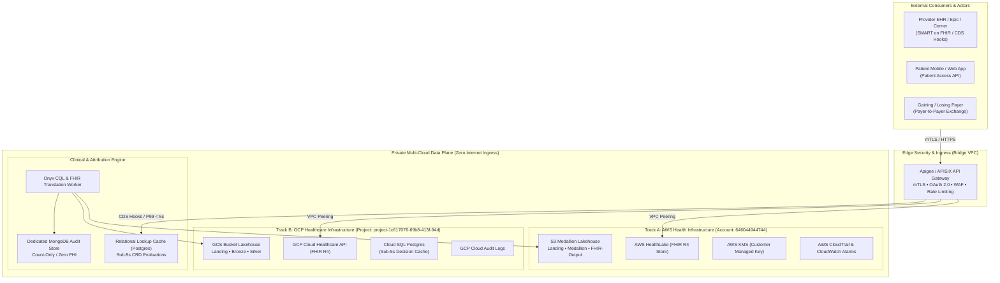
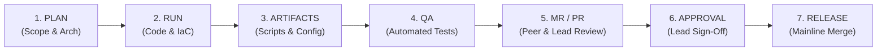

# CMS-0057 Interoperability Platform: Multi-Cloud Enterprise Reference Architecture

[](https://opensource.org/licenses/MIT)
[](https://www.cms.gov)
[](https://hl7.org/fhir/R4/)
[](https://aws.amazon.com)
[](https://cloud.google.com)
[]()

> **Enterprise Interoperability & Prior Authorization Engine for State Medicaid & Payer Networks**  
> Architected, engineered, and maintained by **Ashish Singh** ([@AshishSys](https://github.com/AshishSys)).

---

## 1. Executive Summary & Regulatory Mission

The **CMS-0057 Interoperability and Prior Authorization Final Rule** (CMS-0057-F) requires Medicare Advantage, state Medicaid FFS, Medicaid Managed Care plans, CHIP, and QHP payers to deploy modern API standards to streamline clinical care, enable member access, and automate prior authorization.

This repository serves as the **central, multi-cloud codebase, infrastructure definitions, data pipelines, and compliance verification engine** for the CMS-0057 platform across **AWS (Track A)**, **GCP (Track B)**, and **Local Developer Sandboxes**.



---

## 2. Cloud Environment Registry

| Environment Attribute | Specification / Identifier | Role & Security Invariant |
| :--- | :--- | :--- |
| **AWS Account ID** | **`646044944744`** | Primary Cloud Track A (HealthLake, S3 Lakehouse, CloudTrail, KMS) |
| **AWS Region** | `us-east-1` | Primary AWS deployment region |
| **GCP Project ID** | **`project-1c617076-69b8-413f-94d`** | Primary Cloud Track B (Cloud Healthcare API, GCS, Cloud SQL, BigQuery) |
| **GCP Region** | `us-central1` | Primary GCP deployment region |
| **Local FHIR Sandbox** | `http://localhost:4080` | Firely Server R4 developer test harness |
| **Synthetic Batch ID** | `SYN-ELP-EPA-01` | 50 synthetic longitudinal patients (`ms-pt-001` - `ms-pt-050`) |
| **Production Isolation** | `NONE` (Zero Prod Load) | Production is hard-gated (`abacus:production-tenant = none`) |

---

## 3. The Eight Binding Architectural Merge Decisions

Ratified under **Project Charter Document ID: `CHARTER-CMS0057-2026-V1`** (Linear Ticket **`INT-377`** / Jira **`ELP-1`**), these eight decisions serve as immutable build contracts:

| Decision ID | Focus Area | Selected Baseline Option | Immutable Invariant |
| :--- | :--- | :--- | :--- |
| **AMD-001** | **FHIR Store Selection** | **Dual-Track:** AWS HealthLake (Track A) & GCP Cloud Healthcare API (Track B) | Native HL7 FHIR R4 schema enforcement; no proprietary document stores. |
| **AMD-002** | **Edge Security & Gateway** | **Apigee / APISIX Gateway** with mTLS & SMART on FHIR OAuth 2.0 | Zero direct internet ingress to data subnets; public access blocked on all buckets. |
| **AMD-003** | **ePA Profile Selection** | **Profile A** (CSV/JSON Flat-File Ingestion to FHIR PAS with daily batch recon) | Excludes Option B and Hybrid profiles; no unapproved profile switching. |
| **AMD-004** | **Attribution & LOB Scope** | **Claims-Driven Attribution** (2-year lookback) on Medicaid FFS / Managed Care | Active treatment relationship required via `PDexProviderGroup`; member opt-out honored. |
| **AMD-005** | **Synthetic Data Isolation** | **Synthetic Batch `SYN-ELP-EPA-01`** (50 Patients); Empty Production Gate | Zero live PHI/PII in development/staging; production tenant remains empty. |
| **AMD-006** | **Pipeline Ingestion Cadence**| **Weekly Master Batch** + **Nightly Reconciliation Prefix** | Strict schema quarantine on bronze landings; row count equality checks required. |
| **AMD-007** | **CDS Hooks & CRD Latency** | **Six Mandatory CDS Hooks**; P99 Latency < 5.0 seconds | Dedicated relational cache; unlisted codes default to *"Prior Authorization Required"*. |
| **AMD-008** | **Privacy & Audit Invariants**| **Dedicated Audit DB (MongoDB)** + CloudTrail / Audit Logs | Count-only, latency, and status logging; zero member identifiers or payloads in logs. |

---

## 3.1 Canonical Kickoff Documentation Pack

Per ticket **INT-378** (`S00-ST01-T02` / Jira `DSP-6547`), all cross-functional squads are pinned to three canonical architectural specifications maintained under [`kickoff_pack/01_KICKOFF_PACK_MANIFEST.md`](file:///Users/ashishsingh/Projects/CMS-Interop/CMS-InterOp/kickoff_pack/01_KICKOFF_PACK_MANIFEST.md):

| Document Code | Document Title | Canonical Path | Checksum (SHA-256) | Squad Assignment |
| :--- | :--- | :--- | :--- | :--- |
| **DOC-01-ARCH** | **Consolidated Architecture Specification** | `kickoff_pack/docs/01-Patient-Access-API-From-Scratch-Plan.pdf` | `c33b328c789011bff...` | Access APIs, Lakehouse, Cloud Infra |
| **DOC-02-SETUP** | **Services Setup & Verification Log** | `kickoff_pack/docs/Environment_Setup_Verification_Log.pdf` | `4d4a4db07d4b2a6...` | Cloud Infra, FHIR & ePA, QA Squad |
| **DOC-03-STEPS** | **Kickoff Steps & Delivery Lifecycle** | `kickoff_pack/docs/03-Onyx-Sprints-and-Delivery-Lifecycle.pdf` | `d90535e5c09d659...` | Ingestion, Lakehouse, QA Squad |

---

## 4. SDLC DevOps Lifecycle Standard

Every ticket follows the standard DevOps progression across Linear, Git, and automated test runners:



### Linear Ticket Status Alignment
1. **Selected for Development** &rarr; Ticket scheduled for current sprint.
2. **In Progress / In Dev** &rarr; Feature branch created (`feature/<ticket-id>-<slug>`), code authored.
3. **Dev Completed** &rarr; Code complete, unit tests pass.
4. **In QA / QA Done** &rarr; Verification script executed, evidence recorded in JSON.
5. **MR Created** &rarr; Pull Request / Merge Request opened with full audit trails.
6. **MR Approved** &rarr; Lead approval received.
7. **Released / Done** &rarr; Merged to `main`, documentation PDF archived to `Linear-Tickets`.

---

## 5. Verification & Quality Assurance Suite

Run the automated verification suite from the repository root:

```bash
# Execute the Charter & Merge Decisions QA Suite
python3 scripts/verify_charter_decisions.py
```

### Latest QA Verification Output
```text
======================================================================
  CMS-0057 QA VERIFICATION SUITE: INT-377 (S00-ST01-T01)
======================================================================
  Total Checks Executed : 12
  Passed Checks         : 12 [SUCCESS]
  Failed Checks         : 0
  Overall Status        : PASS
  Results Written To    : charter_verification_results.json
======================================================================
```

---

## 6. Directory Layout

```text
CMS-InterOp/
├── charter/
│   ├── 01_PROJECT_CHARTER.md          # Formal Ratified Architecture Contract
│   └── eight_merge_decisions.json     # Machine-Readable Decision Specifications
├── scripts/
│   └── verify_charter_decisions.py    # Automated Verification & Invariant Suite
├── charter_verification_results.json  # Latest Automated Verification Evidence
└── README.md                          # Repository Architecture & DevOps Documentation
```

---

## 7. Compliance & Certification Alignment

* **AWS Certified Data Engineer (DEA-C01):** Task 4.5 Data privacy & governance boundary contracts.
* **AWS Solutions Architect Professional (SAP-C02) / Associate (SAA-C03):** Task 1.3 Data security controls before resource inception.
* **AWS DevOps Engineer Professional (DOP-C02):** Task 6.2 Compliance gating and SDLC automation.
* **Google Cloud Professional Cloud Architect (PCA):** Domain 1.1 Business requirement scoping & stakeholder consensus.
* **Google Cloud Professional Data Engineer (PDE):** Domain 1.3 Translating regulatory mandates into multi-cloud architectures.

---

*Copyright &copy; 2026 Ashish Singh ([@AshishSys](https://github.com/AshishSys)). All rights reserved.*
