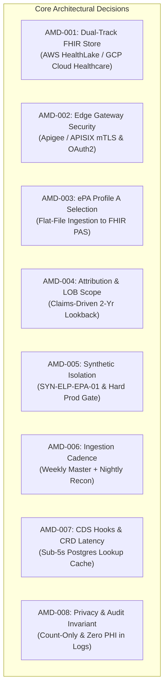

# CMS-0057 Interoperability Platform: Project Charter & Architecture Contract

**Document ID:** CHARTER-CMS0057-2026-V1  
**Project Identifier:** CMS-InterOp (ELP-1 Engagement)  
**Version:** 1.0.0 (Baseline Contract)  
**Status:** APPROVED & LOCKED  
**Date Ratified:** October 13, 2026  
**Security Classification:** Highly Confidential / Regulatory Standard  

---

## 1. Executive Summary & Regulatory Authority

The **CMS-0057 Interoperability and Prior Authorization Final Rule** (CMS-0057-F) mandates Medicare Advantage, state Medicaid Fee-for-Service (FFS) programs, Medicaid Managed Care plans, CHIP, and QHP payers to upgrade electronic health data exchange, automate prior authorization processing, and reduce administrative clinician burden.

This document constitutes the binding **Project Charter and Architecture Contract** for the **CMS-InterOp** enterprise reference implementation across AWS, GCP, and local hybrid environments. Originating from engagement **ELP-1**, this charter locks foundational architectural boundaries. Any modification to the eight core architectural decisions recorded herein requires a formal, approved **Architecture Change Request (CR)**.

### Regulatory Timelines & Scope Boundaries
* **Compliance Baseline & Metrics Collection:** January 1, 2025
* **Initial CMS Metrics Reporting:** March 2026
* **Live API Mandate Deadline:** January 1, 2027 (All endpoints operational)
* **Full Enforcement Deadline:** November 2027

---

## 2. Cloud Environment Registry

All pipeline execution, infrastructure provisioning, and evidence collection are bound to the following designated development environments:

| Environment Attribute | Specification / Identifier | Role & Security Invariant |
| :--- | :--- | :--- |
| **AWS Account ID** | `646044944744` | Primary Cloud Track A (HealthLake, S3 Lakehouse, CloudTrail, KMS) |
| **AWS Region** | `us-east-1` | Primary deployment region |
| **GCP Project ID** | `project-1c617076-69b8-413f-94d` | Primary Cloud Track B (Cloud Healthcare API, GCS, Cloud SQL, BigQuery) |
| **GCP Region** | `us-central1` | Primary deployment region |
| **Local FHIR Sandbox** | `http://localhost:4080` | Firely Server R4 developer test harness |
| **Synthetic Batch ID** | `SYN-ELP-EPA-01` | 50 synthetic longitudinal patients (`ms-pt-001` - `ms-pt-050`) |
| **Production Tenant Status** | `NONE` (Zero Prod Load) | Production is hard-gated (`abacus:production-tenant = none`) |

---

## 3. The Eight Binding Architectural Merge Decisions

To guarantee architectural integrity across distributed engineering squads and prevent scope creep, the following eight decisions are filed as immutable build constraints:

### AMD-001: FHIR Store & Storage Engine Selection
* **Decision:** The enterprise platform implements a **Dual-Track FHIR Datastore Architecture**:
  * **Track A (AWS):** AWS HealthLake (HL7 FHIR R4 standard).
  * **Track B (GCP):** Google Cloud Healthcare API (FHIR R4 dataset & store).
  * **Local/Harness:** Firely Server R4 for local offline unit verification.
* **Invariant:** No sprint or pull request may swap the FHIR datastore, introduce proprietary document stores for primary clinical storage, or bypass FHIR R4 schema validation.
* **Governing Sprints:** S01, S03, S04, S07, S12.

### AMD-002: API Gateway & Public Doorway (Edge Security)
* **Decision:** All external consumer, payer, and provider interactions route through an enterprise **API Gateway Doorway** (Apigee / APISIX proxy) enforcing:
  * mTLS and SMART on FHIR OAuth 2.0 / OpenID Connect token validation.
  * Complete network segregation: External ingress terminates at the gateway in a Bridge VPC; backend data plane subnets remain completely private with no internet egress.
  * Separate pipeline credentials from consumer tokens.
* **Invariant:** Direct public internet exposure of FHIR endpoints, databases, or S3/GCS buckets is categorically prohibited (`BlockPublicAccess = true`).
* **Governing Sprints:** S01, S04, S07, S11.

### AMD-003: Electronic Prior Authorization (ePA) Profile Selection
* **Decision:** Prior authorization adoption adheres strictly to **Profile A** (CSV/JSON Flat-File Ingestion to FHIR PAS with daily batch reconciliation).
* **Rationale:** Maximizes legacy payer/UM vendor compatibility across state Medicaid plans without demanding real-time sub-second core claims adjudication rewrites.
* **Invariant:** Option B (real-time direct UM vendor FHIR-to-FHIR) and unvetted hybrid profiles are out of scope. Downstream PRs cannot unilaterally switch to Option B.
* **Governing Sprints:** S00, S05, S06, S12.

### AMD-004: Attribution Model & Scope of Line of Business (LOB)
* **Decision:** Single Line of Business baseline (Medicaid FFS / Managed Care) utilizing a **claims-driven attribution model**:
  * Active treatment relationships established via 24-month claims and PCP encounter history.
  * Standardized mapping to `PDexProviderGroup` resources at the Organization + Location + Provider level.
* **Invariant:** Dynamic unverified attribution lists or multi-LOB commercial expansions are deferred until post-compliance audits.
* **Governing Sprints:** S00, S02, S03.

### AMD-005: Synthetic Data Isolation & Production Gate Policy
* **Decision:** All development, testing, validation, and benchmarking exclusively utilize the validated synthetic population batch **`SYN-ELP-EPA-01`** (50 patient bundles, manifest, and clinical histories).
* **Invariant:** Real protected health information (PHI) or personally identifiable information (PII) is barred from development and staging accounts. Production tenants remain empty (`abacus:production-tenant = none`) until explicit regulatory sign-off.
* **Governing Sprints:** S00 through S18.

### AMD-006: Pipeline Integration Cadence & Ingestion Pattern
* **Decision:** Data movement follows a deterministic two-speed pattern:
  * **Weekly Master Batch:** Bulk member demographics, coverage, and historical encounters landed with declared schemas and quarantine validation.
  * **Nightly Reconciliation Prefix:** Incremental ClaimResponse and preauthorization EOB mapping.
* **Invariant:** No unstructured streaming directly to gold tables without bronze schema quarantine and identity matching.
* **Governing Sprints:** S02, S03, S05, S06, S08, S14.

### AMD-007: Clinical Decision Support (CDS) Hooks & CRD Latency SLA
* **Decision:** Support all **six standard CRD hooks** (`order-select`, `order-sign`, `appointment-book`, `encounter-start`, `encounter-discharge`, `patient-view`).
  * End-to-end response latency must remain strictly under **5 seconds** (99th percentile).
  * Backed by a dedicated PostgreSQL / Cloud SQL decision cache.
  * **Fail-Safe Compliance Rule:** Any unrecognized or unlisted clinical code defaults to *"Prior Authorization Required"* to eliminate compliance penalties.
* **Invariant:** Real-time CDS hooks must never initiate heavy warehouse table scans during transaction execution.
* **Governing Sprints:** S05, S06, S12.

### AMD-008: Privacy Invariants & Audit Trail Standard
* **Decision:** Continuous audit logging to dedicated MongoDB audit collections and cloud audit platforms (AWS CloudTrail / GCP Cloud Audit Logs):
  * Logs record exclusively: Batch ID, timestamp, calling principal, latency, HTTP response code, and record counts.
  * Zero member identifiers, claim numbers, diagnostic codes, or request payloads may appear in logs, trace outputs, or prompt tokens.
* **Invariant:** Any pipeline step outputting raw clinical payloads to logs or tickets constitutes an immediate severity-1 security failure.
* **Governing Sprints:** S01, S04, S08, S10, S17.

---

## 4. Governance RACI Matrix

| Squad / Role | Accountable Lead | Responsibilities |
| :--- | :--- | :--- |
| **Sponsor / Product Owner** | Ashish Singh | Program acceptance, regulatory scope boundary, change request sign-off |
| **Cloud Infrastructure Squad** | Lead: Cloud Eng | AWS & GCP baseline provisioning, VPC peering, KMS encryption, IAM least privilege |
| **Data Ingestion Squad** | Lead: Ingest Eng | Airbyte connections, landing validation, bronze schema enforcement, quarantine |
| **Lakehouse & Analytics Squad** | Lead: Lakehouse Eng | Silver/Gold transformations, Databricks/Snowflake models, SAM metrics |
| **FHIR & ePA Squad** | Lead: FHIR SME | HealthLake/Healthcare API stores, PAS bundle mapping, CRD hook execution |
| **Access APIs Squad** | Lead: API Architect | Apigee gateway proxying, BluesNet member-match proxy, OAuth2 token service |
| **Quality & Compliance Squad** | Lead: QA Lead | Automated test harnesses, Inferno testing, certification evidence generation |

---

## 5. Architecture Change Control Protocol

Any proposed modification to the architectural baseline must follow this four-stage governance cycle:

1. **Submission:** Formal Architecture Change Request (ACR) filed in Linear referencing this charter and the specific AMD ID.
2. **Impact Assessment:** Evaluation of regulatory deadline impact (CMS-0057), cloud infrastructure cost impact (AWS/GCP), and multi-cloud parity.
3. **Review & Voting:** Review by the Architecture Review Board (ARB) comprising Sponsor, Security Lead, and Cloud Leads.
4. **Ratification:** Unanimous written approval required before any code or Terraform change is merged into main branches.

---

*Certified & Ratified by Ashish Singh, Lead Interoperability Architect.*
