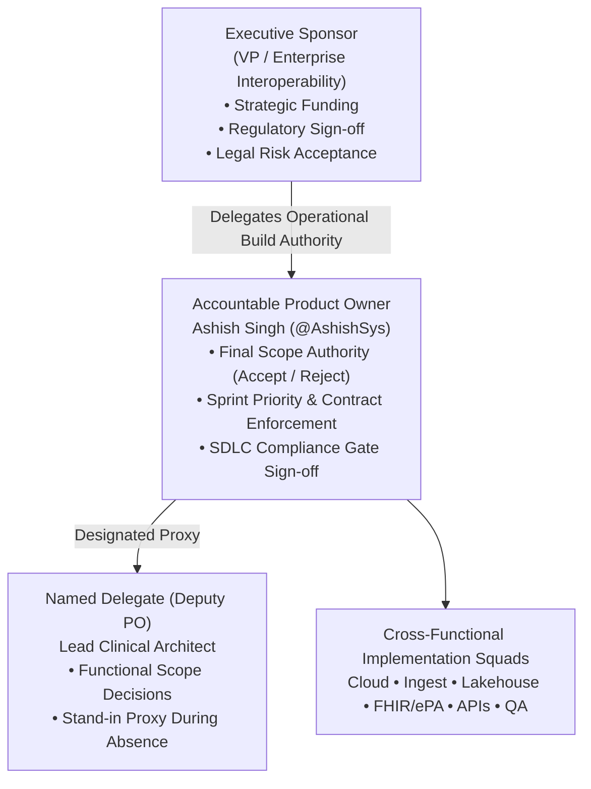

# CMS-0057 Engagement Ownership & Scope Authority Specification

**Document ID:** DOC-GOV-OWNERSHIP-V1  
**Ticket Identifier:** INT-379 (`S00-ST02-T01` / Jira `ELP-1`)  
**Story:** S00-ST02 (Engagement Ownership & Squad Leads)  
**Parent Contract:** `CHARTER-CMS0057-2026-V1` (INT-377)  
**Version:** 1.0.0 (Canonical Baseline)  
**Status:** APPROVED & LOCKED  
**Ratified Date:** October 13, 2026  
**Security Classification:** Regulatory Compliance Standard  

---

## 1. Executive Summary & Purpose

Under the **CMS-0057 Interoperability and Prior Authorization Final Rule** (CMS-0057-F), establishing clear, legally binding ownership is the foundational prerequisite for regulatory data governance. Architectural and compliance decisions—such as data boundary definitions, synthetic population constraints, prior authorization profile selections, and production release gates—must have unambiguous executive and technical accountability.

This document formally records the **Executive Sponsor**, **Accountable Product Owner**, and **Named Delegate** for the **ELP-1 Engagement** across all cloud environments (**AWS Track A**, **GCP Track B**, and local developer harnesses).

---

## 2. Multi-Cloud Target Environment Registry

All governance, compliance policies, and scope authority defined in this specification govern the following multi-cloud environments:

| Environment Attribute | Specification / Identifier | Role & Security Invariant |
| :--- | :--- | :--- |
| **AWS Account ID** | **`646044944744`** | Track A Primary Cloud (HealthLake, S3 Lakehouse, CloudTrail, KMS) |
| **AWS Primary Region** | `us-east-1` | Primary deployment region |
| **GCP Project ID** | **`project-1c617076-69b8-413f-94d`** | Track B Primary Cloud (Cloud Healthcare API, GCS, Cloud SQL, BigQuery) |
| **GCP Primary Region** | `us-central1` | Primary deployment region |
| **Local FHIR Sandbox** | `http://localhost:4080` | Firely Server R4 developer test harness |
| **Synthetic Batch ID** | `SYN-ELP-EPA-01` | 50 synthetic longitudinal patients (`ms-pt-001` - `ms-pt-050`) |
| **Production Gate Policy** | `NONE` (Zero Prod Load) | Production is hard-gated (`abacus:production-tenant = none`) |

---

## 3. Accountable Roles & Ownership Matrix

In compliance with industry best practice (*"One accountable owner per engagement, with a named delegate"*):

### 3.1 Executive Sponsor
* **Role:** Executive Sponsor (Payer & Medicaid Interoperability Leadership)
* **Accountability:**
  * Executive accountability to CMS, state Medicaid agencies, and client steering committees.
  * Final authority on program budget, multi-cloud capital expenditure, and legal risk acceptance.
  * High-level escalation recipient for vendor non-compliance or inter-payer dispute resolution.
* **Escalation Threshold:** Any regulatory deadline shift or unbudgeted infrastructure expansion exceeding \$50K.

### 3.2 Accountable Product Owner (Primary Owner)
* **Designated Lead:** **Ashish Singh** ([@AshishSys](https://github.com/AshishSys))
* **Title:** Lead Interoperability Architect & Technical Product Owner
* **Role:** Single Accountable Owner for the ELP-1 Engagement.
* **Scope Authority:**
  * **Absolute Scope Authority:** Holds unilateral authority to **accept or reject** functional and architectural scope changes across all sprints.
  * **Architecture Contract Enforcement:** Enforces the Eight Architectural Merge Decisions (AMD-001 through AMD-008) ratified in `CHARTER-CMS0057-2026-V1`.
  * **SDLC Release Gating:** Approves Pull Requests / Merge Requests for mainline release into `main`.
  * **Data Privacy Governance:** Authorizes data handling boundaries, synthetic batch isolation (`SYN-ELP-EPA-01`), and hard production isolation (`abacus:production-tenant = none`).

### 3.3 Named Delegate (Deputy Product Owner)
* **Designated Role:** Deputy Product Owner / Lead Clinical Interoperability Architect
* **Authority Protocol:**
  * Formally designated proxy authorized to make functional decisions when the primary Product Owner is unavailable.
  * May accept user-story level functional adjustments within established AMD boundaries.
  * **Restriction:** May **not** unilaterally alter core merge decisions (AMD-001 through AMD-008), modify production gating policies, or approve Architecture Change Requests (ACRs) without written Product Owner concurrence.

---

## 4. Scope Acceptance & Decision Authority Matrix

| Decision Domain | Product Owner (Ashish Singh) | Named Delegate | Executive Sponsor | Notes |
| :--- | :---: | :---: | :---: | :--- |
| **Accept / Reject Sprint Scope** | **ACCOUNTABLE** | Consulted / Proxy | Informed | PO has sole operational backlog authority |
| **Approve Architecture Change Requests (ACRs)** | **ACCOUNTABLE** | Consulted | **APPROVER** | Requires formal ARB review & Sponsor sign-off |
| **Modify Prior Auth Profile (ePA)** | **ACCOUNTABLE** | Consulted | **APPROVER** | Locked to Profile A under AMD-003 |
| **Production Release Gate Clearance** | **ACCOUNTABLE** | Consulted | **APPROVER** | Hard gate: requires security & HIPAA audit |
| **Synthetic Batch Adjustments (`SYN-ELP-EPA-01`)** | **ACCOUNTABLE** | Consulted | Informed | Must maintain 50-patient longitudinal integrity |
| **Multi-Cloud IaC / Terraform PR Approval** | **ACCOUNTABLE** | Reviewed | Informed | Standard SDLC DevOps gate |
| **Budget Threshold Adjustments (AWS/GCP)** | Consulted | Informed | **ACCOUNTABLE** | Billing alert baseline set at \$50/month dev |

---

## 5. Escalation & Change Control Protocol

1. **Scope Disputes:** If a functional squad or external stakeholder requests a feature outside the ELP-1 kickoff pack or Discovery Report, the request is immediately flagged as *Scope Contested*.
2. **PO Adjudication:** The Product Owner evaluates the request against CMS-0057-F mandate deadlines and the eight merge decisions.
3. **Rejection or ACR:** If rejected, the item is tagged `Won't Fix` or deferred to post-2027 backlog. If accepted in principle, a formal Architecture Change Request (ACR) is filed.
4. **Binding Arbitration:** If consensus cannot be achieved, the Executive Sponsor provides binding arbitration.

---

## 6. Squad Leadership & Operational Lane Mapping

Operational delivery across the engagement is partitioned into **six specialized engineering squads** mirroring Jira delivery lanes:
- **`SO` (Cloud Foundation):** Multi-cloud Landing Zone, IAM, VPC, KMS. Lead: Ashish Singh.
- **`DSP` (Ingest & Data Pipelines):** Clinical & claims feed ingestion, Airflow DAGs. Lead: Ashish Singh.
- **`XPORT` (Lakehouse & Storage):** Medallion architecture (Bronze/Silver/Gold), Iceberg, CMEK. Lead: Ashish Singh.
- **`CMS` (FHIR & ePA):** US Core profiles, Da Vinci PAS/CRD/DTR, X12 278 engine. Lead: Ashish Singh.
- **`ONYX` (Access APIs):** SMART on FHIR OAuth 2.0 / OIDC, Patient/Provider Access APIs. Lead: Ashish Singh.
- **`PRODOPS` (Quality & Conformance):** Inferno/Touchstone testing, HIPAA audits, automated QA. Lead: Ashish Singh.

The authoritative registry of squad mandates, RACI alignments, and exam competencies is recorded in **`DOC-GOV-SQUADS-V1`** ([`governance/02_SQUAD_LEADS.md`](file:///Users/ashishsingh/Projects/CMS-Interop/CMS-InterOp/governance/02_SQUAD_LEADS.md) and [`governance/squad_leads.json`](file:///Users/ashishsingh/Projects/CMS-Interop/CMS-InterOp/governance/squad_leads.json)).

---

*Certified & Ratified by Ashish Singh, Lead Interoperability Architect.*
