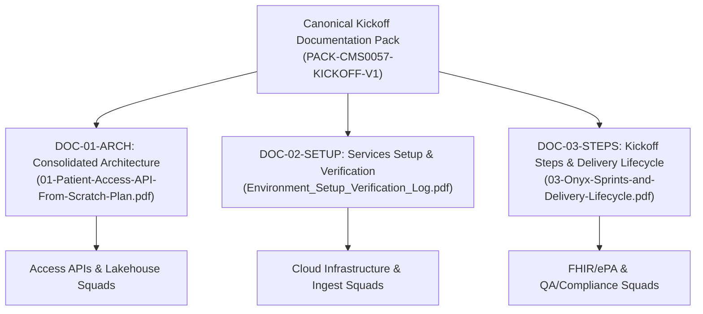

# CMS-0057 Kickoff Documentation Pack Manifest

**Document ID:** PACK-CMS0057-KICKOFF-V1  
**Ticket Identifier:** INT-378 (`S00-ST01-T02` / Jira `DSP-6547`)  
**Story:** S00-ST01 (Discovery & Governance Foundation)  
**Parent Contract:** `CHARTER-CMS0057-2026-V1` (INT-377)  
**Version:** 1.0.0 (Canonical Baseline)  
**Status:** APPROVED & LOCKED  
**Ratified Date:** October 13, 2026  
**Accountable Lead:** Ashish Singh ([@AshishSys](https://github.com/AshishSys))  

---

## 1. Executive Summary & Purpose

Under the CMS-0057 Interoperability and Prior Authorization Final Rule (CMS-0057-F), establishing a single source of truth across all cross-functional engineering squads is essential to ensure regulatory compliance and prevent architectural divergence.

This **Kickoff Documentation Pack Manifest** designates, versions, and binds the **exact three canonical architectural packs** governing the entire project build lifecycle across AWS (Track A), GCP (Track B), and Local Developer environments. All six squads are contractually bound to align their sprint deliverables against these three specifications.

---

## 2. Multi-Cloud Target Environment Registration

All referenced configurations, network topologies, and test suites in this kickoff pack execute against these designated environments:

| Environment Attribute | Identifier / Specification | Role & Security Invariant |
| :--- | :--- | :--- |
| **AWS Account ID** | **`646044944744`** | Track A Primary Cloud (HealthLake, S3 Lakehouse, CloudTrail, KMS) |
| **AWS Primary Region** | `us-east-1` | Primary deployment region |
| **GCP Project ID** | **`project-1c617076-69b8-413f-94d`** | Track B Primary Cloud (Cloud Healthcare API, GCS, Cloud SQL, BigQuery) |
| **GCP Primary Region** | `us-central1` | Primary deployment region |
| **Local FHIR Sandbox** | `http://localhost:4080` | Firely Server R4 developer test harness |
| **Synthetic Batch ID** | `SYN-ELP-EPA-01` | 50 synthetic patients (`ms-pt-001` through `ms-pt-050`) |
| **Production Gate** | `NONE` (Zero Prod Load) | Hard-gated (`abacus:production-tenant = none`) |

---

## 3. The Three Canonical Kickoff Documents

| Document Code | Canonical Document Title | Physical File Path | Pages | Size (Bytes) | SHA-256 Checksum |
| :--- | :--- | :--- | :--- | :--- | :--- |
| **DOC-01-ARCH** | **Consolidated Architecture Specification** | `pdf/01-Patient-Access-API-From-Scratch-Plan.pdf` | 8 | 25,848 | `c33b328c789011bff255e707cf1dd02d4e2fe2de2594d99fefef75efef25ae66` |
| **DOC-02-SETUP** | **Services Setup & Verification Log** | `Environment_Setup_Verification_Log.pdf` | 4 | 18,925 | `4d4a4db07d4b2a6ab4cd160b20ca90689527d9cdf70598a44c351bfb69dad2e1` |
| **DOC-03-STEPS** | **Kickoff Steps & Delivery Lifecycle** | `pdf/03-Onyx-Sprints-and-Delivery-Lifecycle.pdf` | 7 | 25,740 | `d90535e5c09d6595ae31d98e2cde9e599ae96e522652670d6475b1c0d4729942` |

---

## 4. Squad Implementation Directives & Ownership Matrix

Each squad must adhere to the specific directives defined across the three packs:

### 1. Cloud Infrastructure Squad (AWS & GCP)
* **Assigned Directives:** `DOC-01-ARCH` & `DOC-02-SETUP`
* **Mandatory Deliverables:**
  * Provision AWS Account `646044944744` (CloudTrail, S3 Log Bucket, Budgets) and GCP Project `project-1c617076-69b8-413f-94d`.
  * Establish dual-VPC architecture: Private Data VPC (zero internet egress) peered to Bridge VPC (gateway ingress).
  * Customer-managed KMS encryption across all storage tiers; zero public bucket exposure (`BlockPublicAccess=true`).

### 2. Data Ingestion Squad
* **Assigned Directives:** `DOC-01-ARCH` & `DOC-03-STEPS`
* **Mandatory Deliverables:**
  * Implement weekly master domain batch landings (member, coverage, historical encounters) with declared schema validation.
  * Ingest synthetic batch `SYN-ELP-EPA-01` exclusively.
  * Quarantining of records with unmapped fields or schema violations before bronze promotion.

### 3. Lakehouse & Analytics Squad
* **Assigned Directives:** `DOC-01-ARCH` & `DOC-03-STEPS`
* **Mandatory Deliverables:**
  * Build medallion architecture (Bronze &rarr; Silver &rarr; Gold) in Databricks / Snowflake / BigQuery.
  * Enforce row-count equality reconciliations: `landing_count == bronze_count == silver_count`.
  * Nightly ClaimResponse and pre-auth EOB mapping prefixes.

### 4. FHIR & ePA Squad
* **Assigned Directives:** `DOC-01-ARCH` & `DOC-02-SETUP`
* **Mandatory Deliverables:**
  * Deploy dual-track FHIR stores: AWS HealthLake (Track A) and Google Cloud Healthcare API (Track B).
  * Configure local Firely Server R4 sandbox (`http://localhost:4080`) for local offline validation.
  * Execute Profile A flat-file ingestion into FHIR PAS Claim and ClaimResponse resources.
  * Sub-5-second latency SLA for all six CDS Hooks (`order-select`, `order-sign`, `appointment-book`, `encounter-start`, `encounter-discharge`, `patient-view`).

### 5. Access APIs & Security Squad
* **Assigned Directives:** `DOC-01-ARCH` & `DOC-02-SETUP`
* **Mandatory Deliverables:**
  * Configure Apigee / APISIX edge gateway proxying with mTLS and SMART on FHIR OAuth 2.0 token validation.
  * Cryptographically segregate pipeline ingestion service credentials from consumer bearer tokens.
  * Implement BluesNet Proxy integration for out-of-state member match (`$member-match`).

### 6. Quality & Compliance Squad
* **Assigned Directives:** `DOC-02-SETUP` & `DOC-03-STEPS`
* **Mandatory Deliverables:**
  * Execute automated verification test runners across all pull requests before merge.
  * Verify audit trail invariants: count-only logs in MongoDB, zero PHI in logs, prompts, or Linear ticket descriptions.
  * Generate formal completion PDFs adhering to the Plan-Run-Artifacts-QA-Done standard.

---

## 5. Architectural Contract Binding & Version Control

As ratified in the Project Charter (`CHARTER-CMS0057-2026-V1`):
1. **Canonical Location:** The three PDFs and their SHA-256 hashes defined in this manifest represent the single source of truth for the entire engineering program.
2. **Version Pinning:** Any modification, replacement, or re-scoping of any document within this kickoff pack requires an approved Architecture Change Request (ACR) signed off by the Architecture Review Board.

---

*Certified & Ratified by Ashish Singh, Lead Interoperability Architect.*
